# Capital

**Simulador de negocios en 3D.** Empiezas con un puesto de café y $1.500, y construyes un imperio: abres locales,
fijas precios, contratas gente, pides préstamos, compites con rivales y aprendes finanzas de verdad mientras juegas.

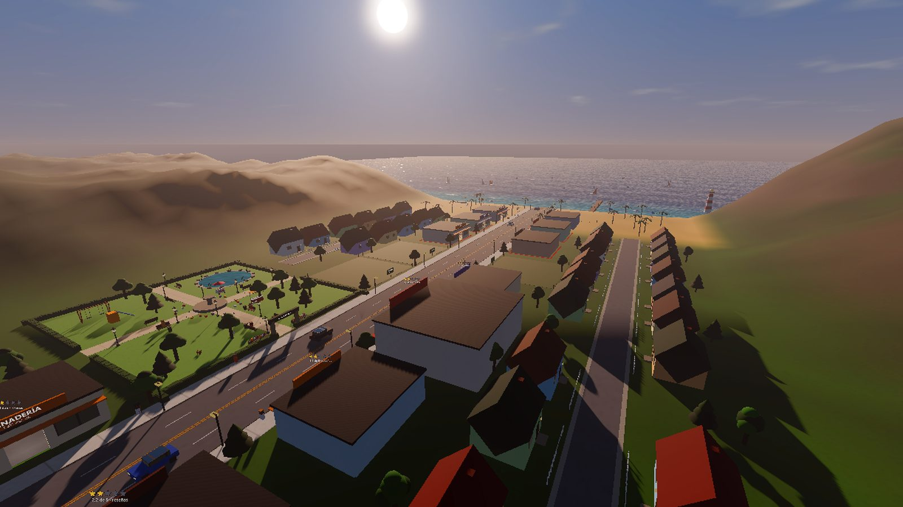

Hecho en **Godot 4.7** (modo Compatibilidad: funciona en tarjetas gráficas modestas como la Intel HD 4600).

## Cómo jugar

- **`Jugar Capital.bat`** abre el juego. **`Abrir en el editor de Godot.bat`** abre el proyecto en el editor.
- Cada partida nueva empieza con un **tutorial guiado** (se puede saltar): aprendes jugando, paso a paso, con una
  flecha grande que te muestra a dónde ir o qué botón apretar, y al final te explica cómo se gana.
- **Meta (modo normal):** que tu empresa valga **$10 millones** (rango Imperio). En el **modo inversionista** empiezas
  con más capital y no hay final.
- Las partidas y los ajustes se guardan en `%APPDATA%\Godot\app_userdata\Capital`. La primera vez, el juego importa
  las partidas de la versión de Python (`../capital/partida*.json`, si existe).

| Tecla | Acción | Tecla | Acción |
|---|---|---|---|
| WASD | caminar | E | interactuar |
| Shift | correr | Tab | tablet |
| Espacio | saltar | O | ir a la oficina |
| Mouse / rueda / V | mirar y cámara | 1 · 2 · 3 | velocidad x1 · x2 · x4 |
| Esc | pausa y menú | P | pausa rápida |
| M | música | F11 | pantalla completa |

Las teclas se cambian en Pausa → Controles.

## El día y la noche

La misma calle a mediodía y a medianoche. De noche la luz sale solo de lo que alumbra en la vida real: faroles, focos
de las casas, vitrinas, ventanas, los autos y el faro.

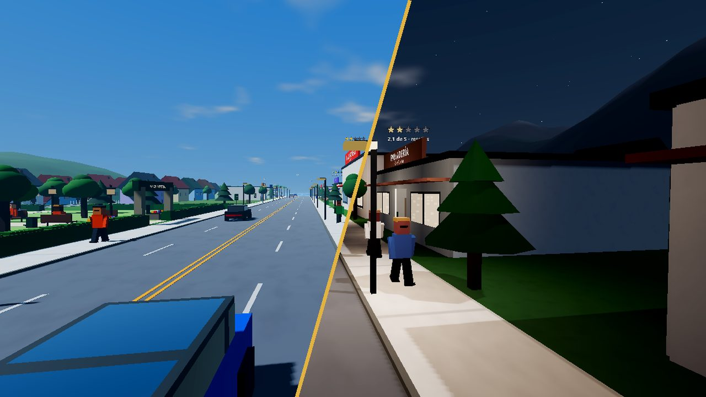

| | |
|---|---|
| 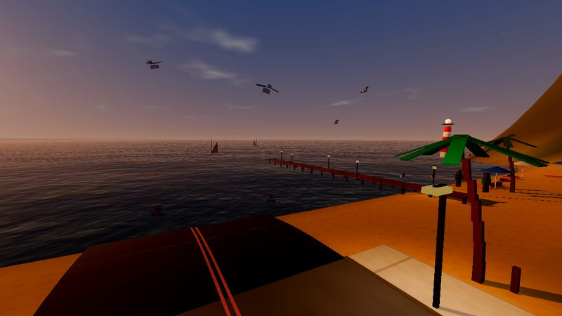 | 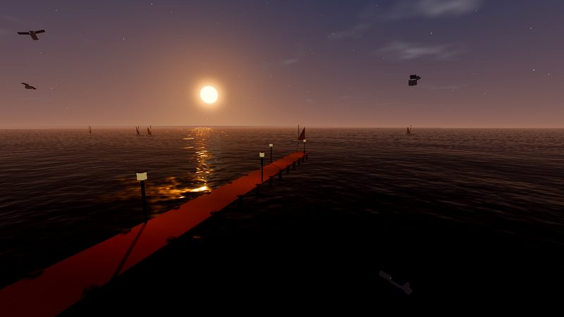 |
| **Paseo de la Playa** al atardecer: el sol se pone en el mar. | **El muelle**: se puede caminar hasta la punta y pescar. |
| 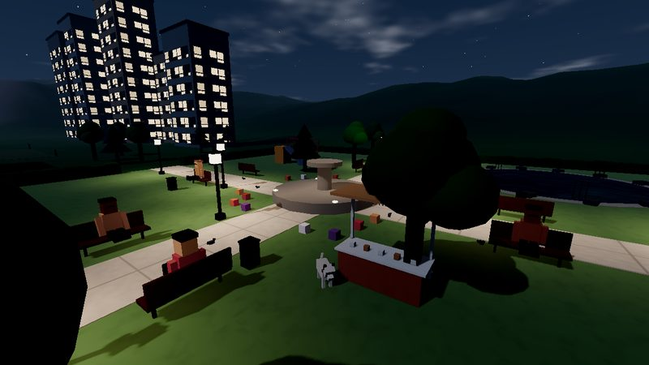 | 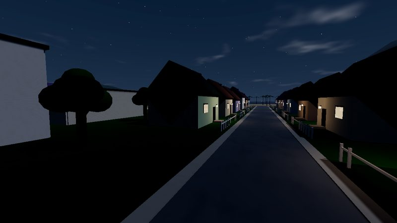 |
| **Parque Central** de noche, con sus faroles y la fuente. | **Barrio Las Lomas**: cada casa con su foco en la entrada. |
| 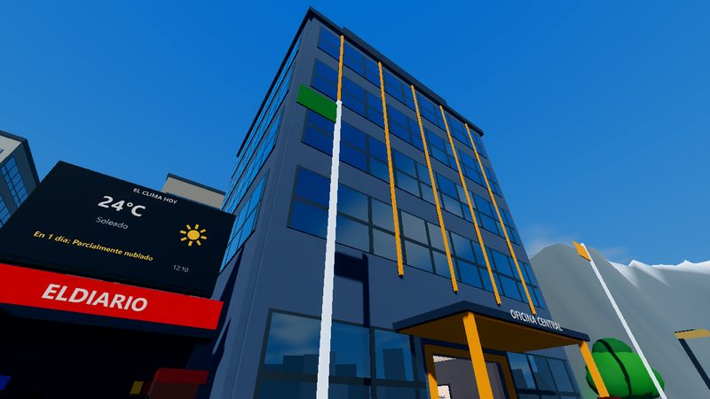 | 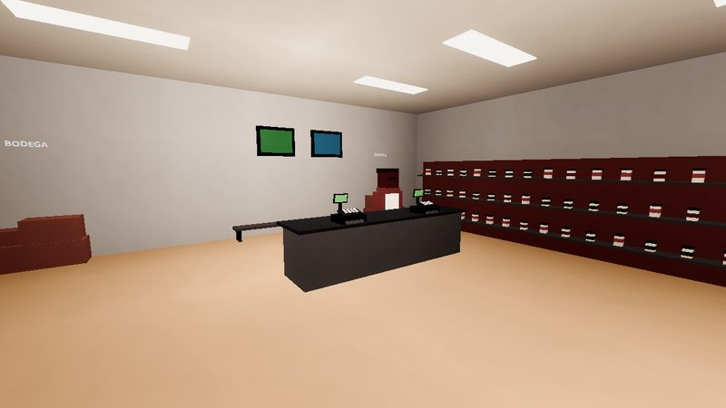 |
| **Tu oficina central** y el kiosco ELDIARIO con el clima. | **Cada local es distinto por dentro**, con su propia luz. |

## Jugando

| | |
|---|---|
| 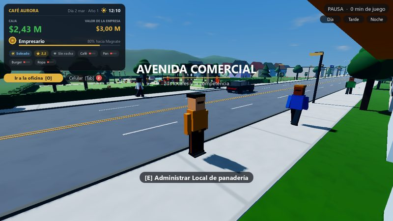 | 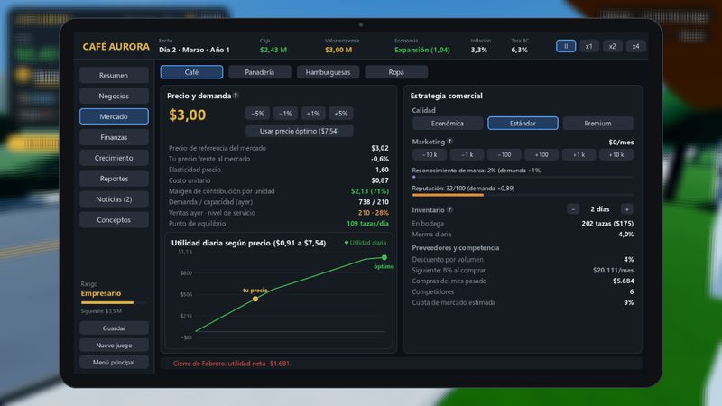 |
| **La avenida**: tus locales, clientes que hacen fila y la tarjeta de tu empresa arriba. | **La tablet**: precios, curva de demanda, calidad, marketing, inventario y finanzas. |
| 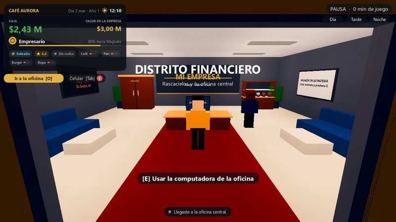 | 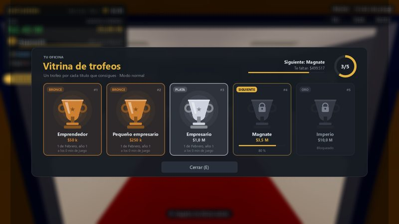 |
| **La oficina**: computadora, estrategia del mes, bolsa, asistente, armario y trofeos. | **Vitrina de trofeos**: uno por cada rango que consigues. |
| 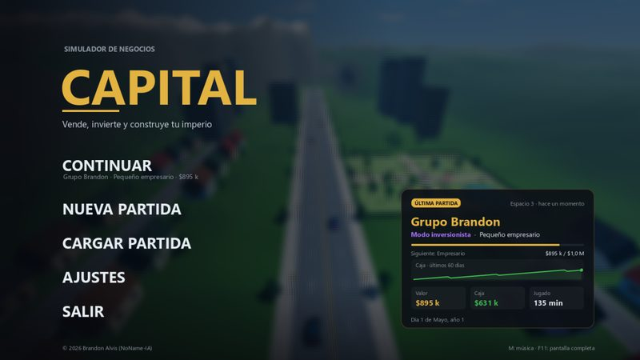 | 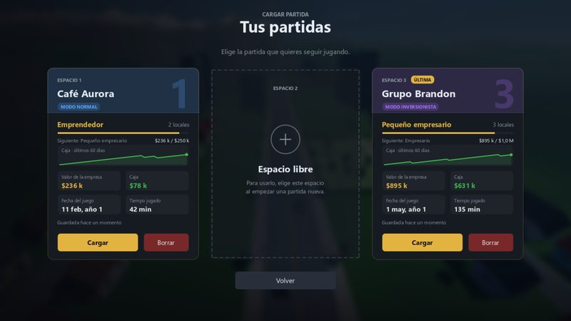 |
| **Pantalla de inicio**: un fondo distinto cada vez y la tarjeta de tu última partida. | **Tus partidas**: 3 espacios con rango, caja de los últimos 60 días y más. |
| 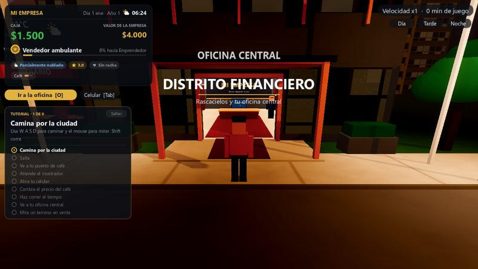 | 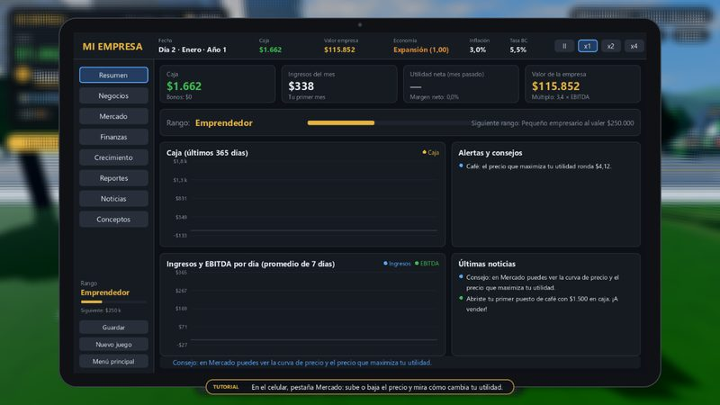 |
| **Tutorial guiado**: los pasos se marcan solos al hacerlos. | Con la tablet abierta, la flecha apunta al botón que hay que apretar. |

## Qué tiene

### Economía (lo que se aprende)

- **Motor económico completo** (`scripts/economy/sim.gd`): productos, sucursales, inventario, precios, calidad,
  marketing, préstamos (sistema francés), bonos, fondo de inversión, impuestos con pérdidas compensables, inflación,
  tasa de política monetaria y ciclo económico. La contabilidad cuadra: una prueba verifica que el patrimonio cambia
  exactamente lo que dice la utilidad neta.
- **Estado de resultados y balance** en Reportes, y **39 conceptos explicados** en la pestaña Conceptos (punto de
  equilibrio, margen de contribución, elasticidad, apalancamiento, escudo fiscal, costo de oportunidad, ROI/ROE/ROA,
  EBITDA, EVA, valoración...).
- **Decisiones urgentes** (soborno, influencer, huelga, franquicia, ciberataque, proveedor exclusivo...) como cartas
  de evento, con cada opción marcada como segura o con riesgo; **reunión de estrategia** una vez al mes.
- **Rivales** que entran al mercado cuando hay ganancias, compran terrenos y te ofrecen comprar tus locales. Sus
  locales aparecen de a poco en la ciudad (uno por cada rival que entra), lejos de tu oficina.
- **Clima que mueve la demanda**: con sol la playa se llena; con lluvia el café se dispara y los puestos al aire libre
  venden menos; con calor lo perecedero se echa a perder; la tormenta vacía la calle. Hay pronóstico.
- **Estrellas de cada local** (1 a 5): suben si atiendes a todos, con buena reputación, calidad y precio justo.
- **Actividades en la ciudad**: en el **parque** repartes muestras (más gente conoce tus marcas), en el **barrio**
  haces una encuesta a los vecinos (te dicen el precio que maximiza tu utilidad), en la **playa** patrocinas el torneo
  de vóley (reputación y más clientes en la playa por 7 días) y en el **muelle** pescas y lo vendes en el puerto.
- **Modos** normal (con final) e inversionista (sin final, 11 rangos hasta Mil millonario).

### La ciudad

- **Zonas**: Avenida Comercial, Distrito Financiero con tu oficina, Parque Central, Barrio Las Lomas, Paseo de la
  Playa con muelle, veleros y faro, y la entrada de la ciudad por el valle de los cerros.
- **Clientes que conversan**: miran el precio, comparan, llaman por teléfono, le preguntan a otro cliente o al
  empleado, y compran o devuelven el producto a la repisa. En la calle comentan tus locales, el clima y la competencia.
- **Empleados que trabajan**: cobran, ordenan repisas, barren, traen cajas de la bodega y descansan en la banca.
  Caminan esquivando muebles y a los demás (AStarGrid2D).
- **Vida**: perritos en el parque, palomas que vuelan si te acercas, gaviotas, gente en las bancas, autos que te
  pueden atropellar y, de vez en cuando, un Tesla blanco que recorre la avenida. La gente se esquiva al caminar (no se
  enciman), y en pausa toda la ciudad se queda quieta.
- **Tu empresa tiene nombre**: sale en los letreros, la oficina, el HUD y lo que dicen los clientes.

### Gráficos

- **Luz de verdad**: sol con sombras largas y color por temperatura (hora dorada al atardecer), tonemap AgX, luna con
  fases que cruza el cielo y se refleja en el mar, estrellas que giran, nubes y niebla.
- **Luz de las lámparas como en Minecraft** (igual que el shader NoName-Shader; `shaders/world.gdshader` y
  `scripts/world/city_lights.gd`): cada luz tiene un nivel que baja 1 por metro, gana la más fuerte, multiplica el color
  de lo que alumbra y no atraviesa paredes. Se calcula una vez en una grilla de celdas de 2 m, así cuesta lo mismo con
  10 luces que con 200.
- **Vidrios con reflejos** del cielo y la ciudad; de noche se prenden las oficinas y las vitrinas.
- **Agua** con olas, turquesa en la orilla y azul profundo mar adentro, espuma y el camino de luz de la luna.
- **Gráficos Bajo, Medio, Alto y Personalizado** (Pausa → Gráficos). Alto imita el shader Eclipse de Minecraft:
  sombras de 4096 px y oclusión ambiental hecha a mano.

### Interfaz

- **Pantalla de inicio** con un fondo distinto cada vez que entras (lugar y hora de la ciudad al azar), la tarjeta de
  tu última partida y pantallas de cargar y crear partida con tarjetas por espacio.
- **Tutorial guiado** de 11 pasos que se hacen jugando (caminar, atender, abrir la tablet, ver cuánto vale tu empresa,
  poner el precio óptimo, contratar, acelerar el tiempo, ir a la oficina y mirar un terreno). Cada paso dice cómo
  hacerlo y para qué sirve para ganar; una flecha grande señala el lugar en la ciudad (con un haz de luz) o el botón
  en la pantalla. Termina con la tarjeta **Cómo se gana**. Sale en cada partida nueva y se puede saltar.
- **Avisos como notificaciones de la tablet**, carteles grandes para los hitos, alarma de quiebra, confeti y música que
  se pone tensa cuando hay peligro.
- **Ventana que recuerda su tamaño y posición**, y pantalla completa con F11.

## Rendimiento

El proyecto usa el modo gráfico **Compatibilidad** (OpenGL/ANGLE) para funcionar en tarjetas como la Intel HD 4600.
En esa tarjeta, a 1600 × 900 con una partida andando: Bajo va a unos 53 FPS, Medio a 45 y Alto a 32. La luz de las
lámparas casi no cuesta, porque se calcula una sola vez en la grilla y no por cada luz. `tests/shot_graphics.gd` saca
capturas de cada nivel y mide los FPS.

## Estructura

```
capital_godot/
├── assets/
│   ├── icono/        capital.png y capital.ico (icono del juego, de la ventana y del .exe)
│   ├── imagenes/     imágenes del tutorial
│   └── sonidos/      música (musica/*.mp3) y efectos (.wav)
├── docs/fotos/       las fotos de este README
├── scenes/           main.tscn, la escena principal
├── scripts/
│   ├── core/         main.gd (arranque, capas y escenarios de prueba) y city.gd (la ciudad, el jugador y los ajustes)
│   ├── economy/      sim.gd (motor económico), data.gd (datos fijos) y fmt.gd (formato de números)
│   ├── systems/      graphics.gd (niveles de gráficos), keys.gd (controles) y sfx.gd (música y sonidos)
│   ├── ui/           admin.gd (menús y tablet), imui.gd (interfaz), HUD, avisos, ventanas, tutorial e íconos
│   └── world/        edificios, terreno, personas, ropa, autos, cielo, luces de la ciudad, clima y materiales
├── shaders/          material de la ciudad, vidrio, agua, cielo, oclusión ambiental, destello del sol y desenfoque
└── tests/            pruebas del motor (run_tests.tscn) y escenarios que sacan capturas
```

## Pruebas

```
Godot_v4.7.2-stable_win64_console.exe --headless --path . res://tests/run_tests.tscn
```

Pruebas del motor económico: identidad contable, dilemas, guardado, armario, modos, fondo, estrategias, terrenos de
los rivales, clima, estrellas y actividades de la ciudad. Los escenarios con capturas se corren así:
`Godot... --path . -- --scenario=res://tests/shot_game.gd` (quedan en `tests/shots/`). Las fotos de este README salen
de `tests/make_readme_photos.gd`. Las pruebas guardan en una carpeta aparte (`user://pruebas`), así que no tocan tus
partidas.

## Licencia

Copyright © 2026 Brandon Alvis (NoName-IA). **Todos los derechos reservados.**

El código está publicado solo para que se pueda ver. No se permite copiarlo, modificarlo, distribuirlo ni usarlo en
otros proyectos sin permiso escrito del autor. Ver [`LICENSE`](LICENSE).
